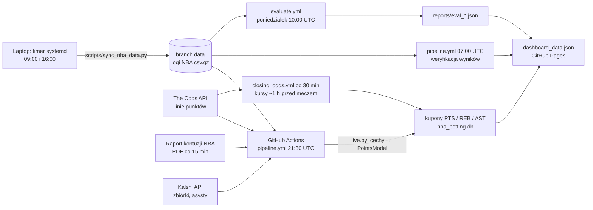

# NBA Betting — model punktów, zbiórek i asyst zawodników vs rynek

Projekt badawczy: przewiduje punkty, zbiórki i asysty zawodników NBA i porównuje te prognozy z rynkiem (player props, over/under). Punkty: linie bukmacherów z The Odds API. Zbiórki i asysty: darmowe, publiczne ceny Kalshi.

**Dashboard:** https://K4j745.github.io/nba_betting/dashboard.html

> [!WARNING]
> **Model nie ma przewagi nad rynkiem.** Uczciwa ewaluacja walk-forward ([reports/eval_2026-10-30.json](reports/eval_2026-10-30.json): 905 linii Pinnacle i 1011 Unibet z marca–czerwca i października 2026) pokazuje, że kursy po zdjęciu marży przewidują wynik lepiej niż model. Δ log-loss vs Pinnacle wynosi +0,035, CI95 [+0,016; +0,055]. Kupon na dashboardzie to **symulacja (paper trading)**: zbiera wyniki poza próbą, nie jest rekomendacją zakładów.

## Jak to działa



- **Dane NBA** pobiera laptop. stats.nba.com nie odpowiada adresom chmurowym, w tym runnerom GitHub Actions, co sprawdził `probe.yml`. Laptop wypycha logi na branch `data`, który ma zawsze jeden commit.
- **Kursy punktów** pochodzą z The Odds API: Pinnacle, Unibet i inni bukmacherzy dostępni w API. Betclic nie jest scrapowany.
- **Zbiórki i asysty** w The Odds API kosztowałyby osobne kredyty, więc ceny bierzemy z publicznego API Kalshi (bez klucza, [kalshi.py](kalshi.py)). Kalshi to giełda zdarzeń dostępna tylko w USA; tu służy wyłącznie jako odniesienie rynkowe. Kurs w kuponie = 1 / (cena kontraktu + prowizja Kalshi).
- **Kontuzje:** oficjalny raport NBA (`ak-static.cms.nba.com/referee/injury/…pdf`, [injuries.py](injuries.py)). Zawodnicy Out/Doubtful zasilają cechy absencji kolegów w modelu live. Walidacja na grudniu 2025: każdy oznaczony Out/Doubtful rzeczywiście nie zagrał (precyzja 100%), a raport z 18:00 ET wychwytuje 71% nieobecnych z rotacji.
- **Model** trenuje się od nowa przy każdym uruchomieniu (~5 s), więc w repo nie ma pickli.

## Model

`PointsModel` ([points_model.py](points_model.py)):
1. XGBoost przewiduje oczekiwane punkty μ.
2. Odchylenie σ(μ) = a + b·μ jest dopasowane na zbiorze walidacyjnym (ostatnie 6000 występów przed datą odcięcia).
3. P(over) = 1 − Φ((linia − μ) / σ) dla punktów. Dla zbiórek i asyst rozkład normalny zawyżał P(over) o 6–8 pp, bo to małe, prawoskośne liczby całkowite. Używamy więc rozkładu ujemnego dwumianowego o tej samej średniej i wariancji. Na sezonie 2025-26 średnie P(over) wynosi wtedy 0,440 przy faktycznych 0,441 (REB) i 0,423 przy 0,425 (AST).

Ten sam model (`train_points_model(..., target="REB"|"AST")`) działa dla każdej statystyki, z własnym zestawem cech (`history.TARGETS`): forma danej statystyki, zbiórki w ataku, zbiórki/asysty oddawane przez rywala na 100 posiadań oraz „zwolnione” zbiórki/asysty nieobecnych kolegów.

Cechy ([history.py](history.py)) są liczone **point-in-time**: wyłącznie z meczów rozegranych przed danym spotkaniem (`shift(1)` przed oknami kroczącymi). Ta sama funkcja `make_features` buduje zbiór treningowy i wiersze meczów, które dopiero się odbędą.

| Zestaw | Cechy | MAE 2025-26 (punkty) | Δ log-loss vs Pinnacle |
|---|---|---|---|
| `base` (26) | forma punktowa (średnie 5/10, EWM, sezon), minuty, rzuty, USG%, odpoczynek, back-to-back, dom/wyjazd, tempo i obrona rywala, forma drużyny | 4,535 | +0,035 |
| `absence` (+6) | absencje kolegów: liczba, „zwolnione” minuty / punkty / rzuty | **4,454** (lepiej, CI95 [−0,095; −0,066]) | +0,038 |
| `efficiency` (+3) | TS% (10 meczów, sezon), średni Game Score | 4,535 (bez zmian) | +0,033 |
| `fatigue` (+7) | mecze i minuty w 7 dniach, 3 mecze w 4 dni, km podróży, zmiana strefy czasowej, seria wyjazdowa, mecz na wysokości (DEN/UTA) | bez zmian (Δ −0,0004, CI zawiera 0) | +0,034 |
| `context` (+4) | oczekiwane punkty drużyny, suma i różnica punktów meczu z ratingów ofensywnych/defensywnych i tempa (zastępstwo spreadu i totalu) | bez zmian (Δ +0,0007, CI zawiera 0) | +0,033 (vs base −0,0027, CI [−0,006; +0,001]) |

Model live używa zestawu `base`. Wiersze `fatigue` i `context` (krok 4c) liczone na innym zbiorze testowym niż starsze wiersze; porównuj Δ względem `base` z tego samego przebiegu. Przed meczem nie wiadomo, kto nie zagra, bo brakuje źródła raportów kontuzji. Poza tym żaden zestaw cech nie poprawia wyniku **względem rynku**. Najbliżej jest `context`: na liniach bukmacherów MAE −0,039 (CI bez zera), ale log-loss bez istotnej zmiany i brak efektu na pełnym holdoucie, więc to kandydat do obserwacji, nie zmiana modelu.

### Testy hipotez (krok 5)

[hypotheses.py](hypotheses.py) → `reports/hypotheses_*.json`. Reszta = punkty − prognoza modelu poza próbą (sezony 2023-24 … 2026-27, 86 tys. występów). CI95 z bootstrapu po zawodnikach.

| Hipoteza | n | Średnia reszta z flagą − bez (CI95) | Wniosek |
|---|---|---|---|
| revenge: mecz z byłą drużyną | 2235 | +0,09 [−0,17; +0,35] | brak efektu |
| revenge: pierwszy mecz po odejściu | 537 | −0,01 [−0,48; +0,49] | brak efektu |
| revenge: do 365 dni od odejścia | 906 | +0,19 [−0,18; +0,54] | brak efektu |
| nemesis: najgorszy rywal zawodnika (≥ 3 mecze) | 2236 | −0,19 [−0,44; +0,07] | brak efektu |
| nemesis: nachylenie reszty względem wcześniejszych reszt z tym rywalem | 38 971 | 0,053 [0,006; 0,104] | statystycznie na granicy, praktycznie ~0,07 pkt na odchylenie standardowe |

Na liniach bukmacherów revenge wypada pod linią (19 overów na 60 linii). To jednak ok. 30 niezależnych występów, rynek nie wycenia tych meczów inaczej niż pozostałych, a na 2235 meczach efektu brak. Uznaję to za szum. Nemesis „zawodnik vs konkretny obrońca” wymaga danych o pojedynkach (BoxScoreMatchups), których nie pobieramy.

### Line shopping (krok 6)

[line_shopping.py](line_shopping.py) → `reports/line_shopping_*.json`. Pinnacle po zdjęciu marży służy jako cena referencyjna. Różne linie (np. 24,5 vs 25,5) są przeliczane przez rozkład normalny z σ(μ) modelu.

| Analiza | Wynik (Pinnacle + Unibet, 921 par linii) |
|---|---|
| Marża: jeden bukmacher → najlepsza cena z dwóch | 6,7–7,2% → 4,9%; 6 arbitraży na 641 grup (max 2,9%) |
| Unibet bije uczciwą cenę Pinnacle o EV > 3% | 49 zakładów, ROI +12% [−20%; +44%] |
| CLV tych zakładów (tylko 44 z późniejszym odczytem Pinnacle) | −0,7% [−3,2%; +1,2%]: EV w chwili zakładu (+2,6%) znika, bo Pinnacle przesuwa się w stronę Unibetu |
| Model (base) po najlepszej cenie zamiast u jednego bukmachera | ROI wyższy o ~2 pp, nadal bez istotnej przewagi |

Line shopping obniża marżę, ale **przewagi nie daje**. Od 2026-10-30 pipeline pobiera kursy 10 bukmacherów z regionu `eu`, w tym Betclic FR (`betclic_fr`), bez dodatkowego kosztu w Odds API. Polskiego betclic.pl nie ma w API. Scrapingu nie wdrażam: regulaminu betclic.pl pod tym kątem nie weryfikowałem, a bukmacherzy zwykle zabraniają automatycznego pobierania.

## Struktura

| Plik | Rola |
|---|---|
| `history.py` | Logi sezonów 2021-22+ z `nba_api` (`LeagueGameLog`), tabela mecz–zawodnik, cechy point-in-time, zbiór `data/player_games.csv.gz` |
| `points_model.py` | `PointsModel` i `train_points_model` (PTS / REB / AST) |
| `injuries.py` | Oficjalny raport kontuzji NBA (PDF) → Out/Doubtful; `--validate` porównuje z logami |
| `kalshi.py` | Ceny Kalshi: historia rozliczonych rynków (`data/raw/kalshi_lines.csv.gz`, archiwum przez bisekcję drabinki progów) i linie na żywo |
| `evaluate_stats.py` | Model vs Kalshi dla PTS / REB / AST (walk-forward tygodniowo) → `reports/eval_stats_*.json` |
| `evaluate.py` | Ewaluacja walk-forward vs rynek: log-loss/Brier vs kursy bez marży, bootstrap CI, symulacja zakładów EV, ablacja zestawów cech → `reports/` |
| `hypotheses.py` | Testy hipotez revenge / nemesis na resztach modelu poza próbą → `reports/hypotheses_*.json` |
| `line_shopping.py` | Krok 6: wartość względem Pinnacle (EV, CLV), najlepsza cena, model po najlepszej cenie → `reports/line_shopping_*.json` |
| `live.py` | Kupony dnia: propsy → cechy → model → tabela `live_predictions` + picki (EV ≥ 5%, max 1 na mecz; kurs 1,40–1,90 dla PTS, 1,40–2,60 dla REB/AST z Kalshi). REB/AST w tabeli `stat_coupons`, wyniki liczone z logów (`stat_results`) |
| `main.py` | Pipeline uruchamiany przez Actions: kursy, kupon, weryfikacja, eksport dashboardu |
| `odds_fetcher.py` | The Odds API |
| `tracker.py` | Weryfikacja kuponów i statystyki (SQLite `nba_betting.db`) |
| `dashboard.html` | Statyczny dashboard (Chart.js) z boiskiem w tle; zakładki Punkty / Zbiórki / Asysty (`#reb`, `#ast`) |
| `scripts/sync_nba_data.py` | Laptop → branch `data` (logi NBA + nowe rynki Kalshi) |
| `scripts/install_data_timer.sh` | Instalacja timera systemd (`--uninstall` usuwa) |
| `.github/workflows/` | `pipeline.yml` (kupon i weryfikacja), `closing_odds.yml` (kursy zamknięcia ~1 h przed meczem, z budżetem kredytów), `evaluate.yml` (raport tygodniowy), `probe.yml` (test dostępu do stats.nba.com) |
| `model.py`, `features.py`, `train.py`, `data_fetcher.py` | Stara ścieżka (`PropPredictor`), nieużywana w pipeline |

## Uruchomienie lokalne

```bash
python3 -m venv .venv && .venv/bin/pip install -r requirements.txt
```

```bash
.venv/bin/python history.py --refresh-current
```

```bash
.venv/bin/python evaluate.py
```

```bash
.venv/bin/python -m pytest tests/
```

Podgląd dashboardu: `python3 -m http.server 8080`, potem `http://localhost:8080/dashboard.html`.

### Timer synchronizacji danych (laptop)

```bash
scripts/install_data_timer.sh
```

```bash
systemctl --user list-timers nba-data-sync.timer
```

Timer działa, gdy użytkownik jest zalogowany. Bez logowania potrzebne jest `loginctl enable-linger`.

### Sekrety GitHub Actions

- `ODDS_API_KEY`: klucz The Odds API.

## Ograniczenia

- Raport kontuzji wychwytuje ok. 70% nieobecnych z rotacji (decyzje trenera, późne zmiany). Model live zna więc absencje tylko częściowo.
- Kalshi: historia od grudnia 2025. Rynki z archiwum mają ceny tylko wokół linii głównej, bo świece archiwum pobiera się pojedynczo. Płynność jest mniejsza niż u bukmacherów (spread zwykle 2–4 ¢; rynki ze spreadem > 10 ¢ są pomijane).
- Linie z The Odds API pochodzą od bukmacherów europejskich (10 w regionie `eu`). Betclic tylko w wersji francuskiej (`betclic_fr`).
- Brak historii spreadów i totali meczów (historyczne kursy Odds API są w płatnych planach; cennika nie weryfikowałem). Od 2026-10-30 pipeline zapisuje je codziennie do tabeli `game_lines` (2 kredyty Odds API na run). Posłużą do treningu, gdy zbierze się sezon.
- Laptop musi się włączać. Gdy dane są starsze niż 2 dni, kupon nie powstaje (`nba_data_stale`).
- Dane Sports-Reference/Stathead nie są używane: regulamin zabrania ich użycia do trenowania modeli.
