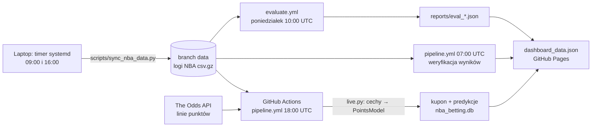

# NBA Betting — model punktów zawodników vs rynek

Projekt badawczy: przewiduje liczbę punktów zawodników NBA i porównuje te prognozy z liniami bukmacherów (player props, over/under punktów).

**Dashboard:** https://K4j745.github.io/nba_betting/dashboard.html

> [!WARNING]
> **Model nie ma przewagi nad rynkiem.** Uczciwa ewaluacja walk-forward ([reports/eval_2026-10-30.json](reports/eval_2026-10-30.json): 905 linii Pinnacle i 1011 Unibet z marca–czerwca i października 2026) pokazuje, że kursy po zdjęciu marży przewidują wynik lepiej niż model. Δ log-loss vs Pinnacle wynosi +0,035, CI95 [+0,016; +0,055]. Kupon na dashboardzie to **symulacja (paper trading)**: zbiera wyniki poza próbą, nie jest rekomendacją zakładów.

## Jak to działa



- **Dane NBA** pobiera laptop. stats.nba.com nie odpowiada adresom chmurowym, w tym runnerom GitHub Actions, co sprawdził `probe.yml`. Laptop wypycha logi na branch `data`, który ma zawsze jeden commit.
- **Kursy** pochodzą z The Odds API: Pinnacle, Unibet i inni bukmacherzy dostępni w API. Betclic nie jest scrapowany.
- **Model** trenuje się od nowa przy każdym uruchomieniu (~5 s), więc w repo nie ma pickli.

## Model

`PointsModel` ([points_model.py](points_model.py)):
1. XGBoost przewiduje oczekiwane punkty μ.
2. Odchylenie σ(μ) = a + b·μ jest dopasowane na zbiorze walidacyjnym (ostatnie 6000 występów przed datą odcięcia).
3. P(over) = 1 − Φ((linia − μ) / σ).

Cechy ([history.py](history.py)) są liczone **point-in-time**: wyłącznie z meczów rozegranych przed danym spotkaniem (`shift(1)` przed oknami kroczącymi). Ta sama funkcja `make_features` buduje zbiór treningowy i wiersze meczów, które dopiero się odbędą.

| Zestaw | Cechy | MAE 2025-26 (punkty) | Δ log-loss vs Pinnacle |
|---|---|---|---|
| `base` (26) | forma punktowa (średnie 5/10, EWM, sezon), minuty, rzuty, USG%, odpoczynek, back-to-back, dom/wyjazd, tempo i obrona rywala, forma drużyny | 4,535 | +0,035 |
| `absence` (+6) | absencje kolegów: liczba, „zwolnione” minuty / punkty / rzuty | **4,454** (lepiej, CI95 [−0,095; −0,066]) | +0,038 |
| `efficiency` (+3) | TS% (10 meczów, sezon), średni Game Score | 4,535 (bez zmian) | +0,033 |
| `fatigue` (+7) | mecze i minuty w 7 dniach, 3 mecze w 4 dni, km podróży, zmiana strefy czasowej, seria wyjazdowa, mecz na wysokości (DEN/UTA) | bez zmian (Δ −0,0004, CI zawiera 0) | +0,034 |
| `context` (+4) | oczekiwane punkty drużyny, suma i różnica punktów meczu z ratingów ofensywnych/defensywnych i tempa (zastępstwo spreadu i totalu) | bez zmian (Δ +0,0007, CI zawiera 0) | +0,033 (vs base −0,0027, CI [−0,006; +0,001]) |

Model live używa zestawu `base`. Wiersze `fatigue` i `context` (krok 4c) liczone na innym zbiorze testowym niż starsze wiersze; porównuj Δ względem `base` z tego samego przebiegu. Przed meczem nie wiadomo, kto nie zagra, bo brakuje źródła raportów kontuzji. Poza tym żaden zestaw cech nie poprawia wyniku **względem rynku**. Najbliżej jest `context`: na liniach bukmacherów MAE −0,039 (CI bez zera), ale log-loss bez istotnej zmiany i brak efektu na pełnym holdoucie, więc to kandydat do obserwacji, nie zmiana modelu.

## Struktura

| Plik | Rola |
|---|---|
| `history.py` | Logi sezonów 2021-22+ z `nba_api` (`LeagueGameLog`), tabela mecz–zawodnik, cechy point-in-time, zbiór `data/player_games.csv.gz` |
| `points_model.py` | `PointsModel` i `train_points_model` |
| `evaluate.py` | Ewaluacja walk-forward vs rynek: log-loss/Brier vs kursy bez marży, bootstrap CI, symulacja zakładów EV, ablacja zestawów cech → `reports/` |
| `live.py` | Kupon dnia: propsy → cechy → model → tabela `live_predictions` + picki (EV ≥ 5%, kurs 1,40–1,90, max 1 na mecz) |
| `main.py` | Pipeline uruchamiany przez Actions: kursy, kupon, weryfikacja, eksport dashboardu |
| `odds_fetcher.py` | The Odds API |
| `tracker.py` | Weryfikacja kuponów i statystyki (SQLite `nba_betting.db`) |
| `dashboard.html` | Statyczny dashboard (Chart.js) z boiskiem w tle |
| `scripts/sync_nba_data.py` | Laptop → branch `data` |
| `scripts/install_data_timer.sh` | Instalacja timera systemd (`--uninstall` usuwa) |
| `.github/workflows/` | `pipeline.yml` (kupon i weryfikacja), `evaluate.yml` (raport tygodniowy), `probe.yml` (test dostępu do stats.nba.com) |
| `model.py`, `features.py`, `train.py`, `data_fetcher.py` | Stara ścieżka (`PropPredictor`), nieużywana w pipeline |

## Uruchomienie lokalne

```bash
python3 -m venv .venv && .venv/bin/pip install -r requirements.txt
```

```bash
.venv/bin/python history.py --refresh-current
```

```bash
.venv/bin/python evaluate.py
```

```bash
.venv/bin/python -m pytest tests/
```

Podgląd dashboardu: `python3 -m http.server 8080`, potem `http://localhost:8080/dashboard.html`.

### Timer synchronizacji danych (laptop)

```bash
scripts/install_data_timer.sh
```

```bash
systemctl --user list-timers nba-data-sync.timer
```

Timer działa, gdy użytkownik jest zalogowany. Bez logowania potrzebne jest `loginctl enable-linger`.

### Sekrety GitHub Actions

- `ODDS_API_KEY`: klucz The Odds API.

## Ograniczenia

- Brak raportów kontuzji przed meczem, więc model live nie zna absencji.
- Linie z The Odds API pochodzą od części bukmacherów. Betclic nie jest dostępny.
- Brak historii spreadów i totali meczów (historyczne kursy Odds API są w płatnych planach; cennika nie weryfikowałem). Od 2026-10-30 pipeline zapisuje je codziennie do tabeli `game_lines` (2 kredyty Odds API na run). Posłużą do treningu, gdy zbierze się sezon.
- Laptop musi się włączać. Gdy dane są starsze niż 2 dni, kupon nie powstaje (`nba_data_stale`).
- Dane Sports-Reference/Stathead nie są używane: regulamin zabrania ich użycia do trenowania modeli.
